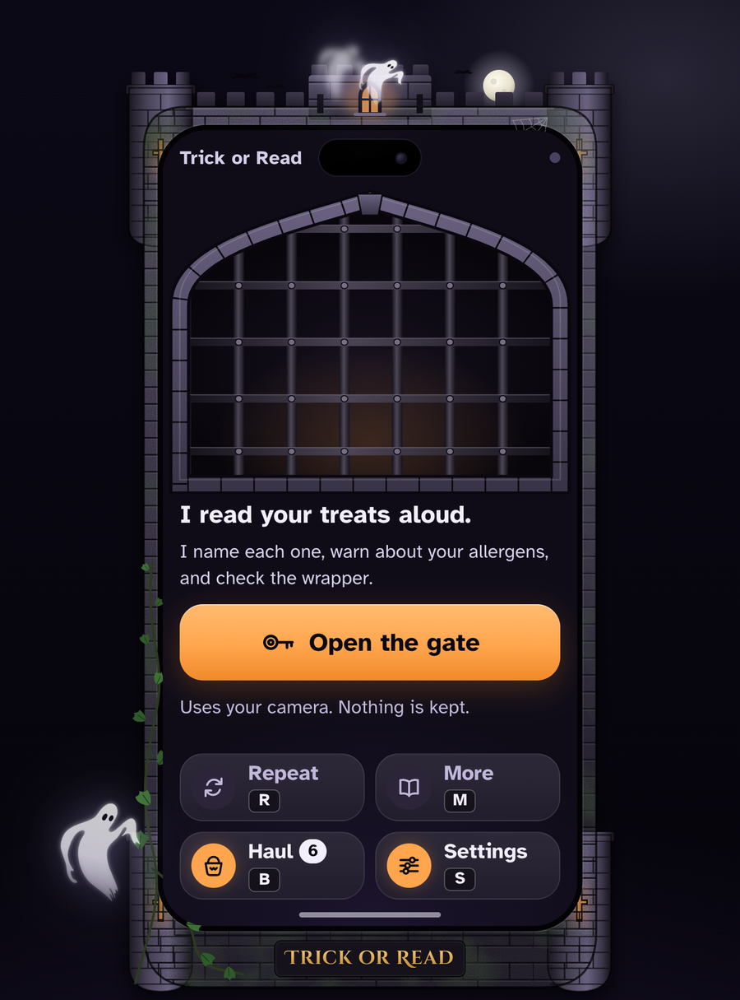
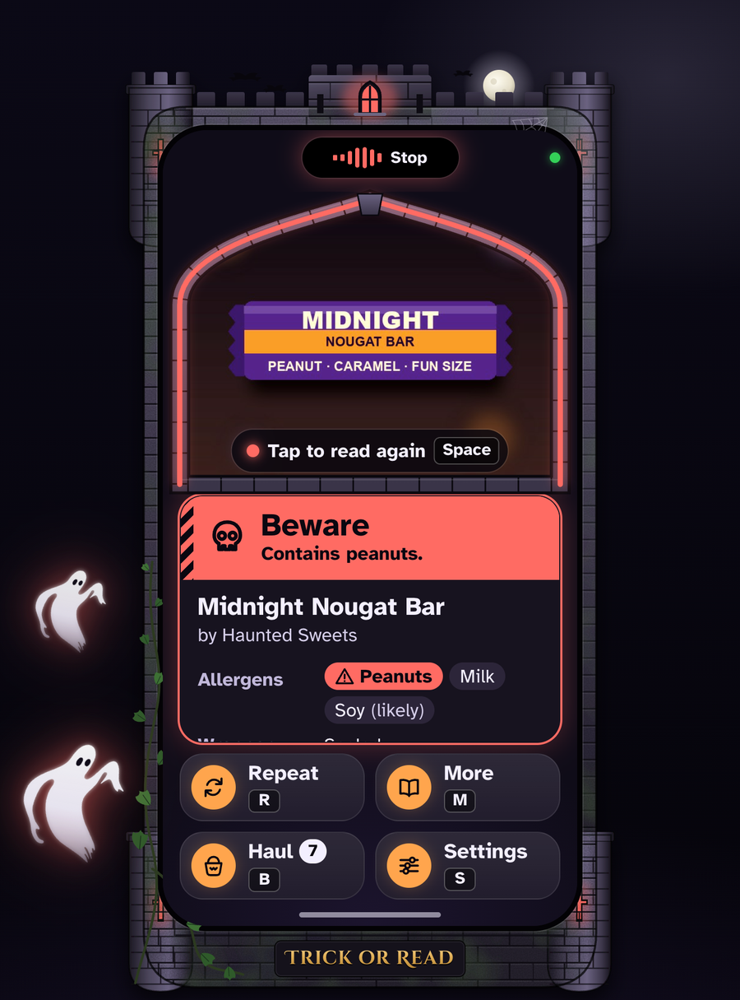
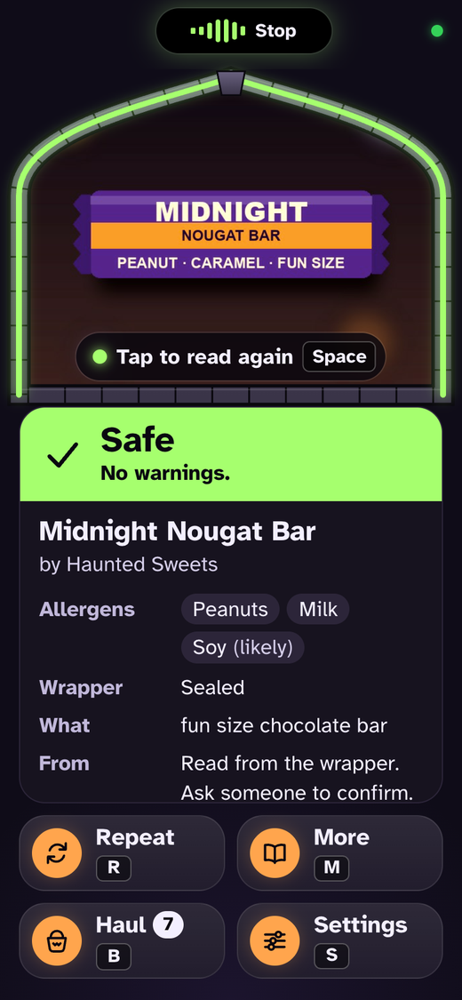
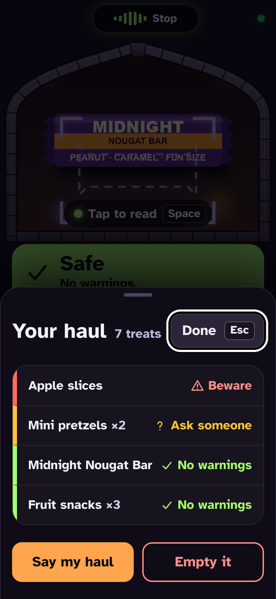

<p align="center">
  
</p>

<p align="center">
  
  
  
  
  
  
  
  
</p>

<p align="center"><em>A talking castle for blind and low-vision trick-or-treaters. Hold a treat to the camera and the castle names it, checks your allergens and tells you if the wrapper is still sealed.</em></p>

<p align="center">
  
</p>

## 🔮 Screenshots

<p align="center">
  <table>
    <tr>
      <td align="center">
        <br>
        <sub>Gate closed, ghosts outside</sub>
      </td>
      <td align="center">
        <br>
        <sub>A Beware read: peanuts</sub>
      </td>
      <td align="center">
        <br>
        <sub>Phone layout: no warnings</sub>
      </td>
      <td align="center">
        <br>
        <sub>Your haul, warnings first</sub>
      </td>
    </tr>
  </table>
</p>

<sub>Screenshots use a made-up treat and a scripted read.</sub>

<p align="center">
  
</p>

## 🎃 How it works

1. **Open the gate.** One big button, already focused: it starts the camera and lets the castle speak. The portcullis
   winds up off the window.
2. **Hold a treat still.** The castle notices something new in the window, waits until it stops moving, and reads it.
   No buttons needed. To read on demand, tap the window (the whole window is the button) or press Space.
3. **Two ways to know what it is.**
   - A **barcode** in view is looked up in [Open Food Facts](https://world.openfoodfacts.org): real label data, real
     allergen lists.
   - Otherwise a **vision model** reads the wrapper. It also checks whether the wrapper is sealed, which only a camera
     can see.
4. **It speaks** with a natural ElevenLabs voice: the name, the kind, any of your allergens, and the wrapper.
   On a phone it also vibrates the verdict. Repeat says it again, More adds ingredients, sugar and calories, Haul lists
   everything you've read.

<p align="center">
  
</p>

## 👻 Never "safe" when we don't know

| Verdict | When |
|---|---|
| **Beware** | one of your allergens is on the label or likely in the treat, or the wrapper is opened, torn or unwrapped |
| **Ask someone** | you have allergens set but there is no allergen label to read, or the read was unsure |
| **Safe** | sealed, and the label lists none of your allergens |

Allergens from a label are said as facts. Allergens the model infers are said as "likely, ask someone to check the label".

<p align="center">
  
</p>

## 🕯️ Built for people who can't see the screen

- **One screen, nothing hidden.** Status bar, window, verdict, four tiles. No tabs, no pages, no gestures to learn.
- **The biggest thing does the most important thing.** The camera window is the Read button, so a blind user can find it by touch
  without hunting.
- **Controls that stay put.** Repeat, More, Haul and Settings are 64px tiles in the same corners every time, so they
  can be found by touch and by memory. Each also has a key (R, M, B, S) and a spoken word.
- **Heard, felt and seen.** Every verdict is a sentence, a sound (a chime, a bright two-note chime, a deep toll) and, on phones, a vibration
  you can count: one buzz no warnings, two ask someone, three long buzzes beware.
- **Stop her any time.** While the voice speaks, the pill at the top of the screen opens into a wave marked Stop; tap it
  (or press Esc).
- **The screen stays awake** while the camera is on, so the camera doesn't stop halfway through a haul.
- **Your screen reader, if you'd rather.** Switch the castle's voice off and everything goes to VoiceOver, TalkBack or NVDA
  instead (never both, so nothing is said twice).
- **Low vision.** Atkinson Hyperlegible (designed by the Braille Institute) for everything you read, 18px or larger,
  7:1 contrast on every surface. Verdicts are solid blocks with an icon and a word, never colour alone. Honors
  reduced motion, more contrast and forced colours. axe finds no violations.

<p align="center">
  
</p>

## 🎭 The voice

Two young Brazilian women from the ElevenLabs voice library, both speaking English:
**Serena** (the default: warm, relaxed, a little playful) and **Ana** (calm and measured, every word clear).
V switches between them; the speed is in Settings. Without an ElevenLabs key the browser's own voice is used.

<p align="center">
  
</p>

## 🏰 The costume, and what each piece does

| Piece | Job |
|---|---|
| The case | a stone castle wrapped around a phone-shaped app: corner turrets for bumpers, battlements, a gatehouse, ivy, bats and the moon. In the desktop app the castle *is* the window: frameless, transparent, dragged by its stone |
| Ghosts | in the style of the WWII "Ghost Army" insignia (traced from it, minus the lightning): swooping white figures with a reaching, ragged hand and a tattered hem. They haunt the air outside the walls: each materialises at a random spot, swoops along the castle and thins away into mist, then appears somewhere else. Their glow takes the verdict colour, so they blush red on a Beware. In the desktop app they fly in their own see-through window wrapped around the castle, which never takes the mouse, so clicks always land on the castle or pass to the desktop. They stay away under reduced motion |
| Portcullis | down across the window until you open the gate; winds up (with a ratchet and a thud) when the camera starts |
| The window | the camera view in a pointed stone arch, and the Read button. Corner brackets show where to hold the treat |
| Candlelight on the arch | climbs both sides while you hold steady, meets at the keystone when it reads; a moonbeam sweeps down while it reads |
| Gatehouse window and arrow slits | the verdict colour: moonlight idle, green safe, amber ask someone, red beware; they flicker while reading |
| The island | the black pill at the top: opens into a wave in the verdict colour while the voice speaks, so a helper knows to listen |
| Verdict card | the verdict as a solid block (icon, word, reason: "Contains peanuts."), then the name and the facts |
| Haul sheet | a jack-o'-lantern pail of everything read, warnings first |
| Sounds | ratchet (gate opens), heartbeat (holding still), chime (read), deep toll (beware), creak (nothing seen), all synthesised |

On a phone the case comes off (the device already is the phone) and the screen fills the page. In a browser that's
zoomed in too far for the case to fit, the same happens, so text keeps the size you asked for. Cmd + / Cmd − make
the whole castle bigger or smaller in the desktop app.

<p align="center">
  
</p>

## 🦇 Keys and voice commands

Space or tap the window: read · R repeat · M more · B haul · S settings · V switch voice · L voice commands · H help ·
Esc stop talking. With voice commands on: "scan", "repeat", "more", "haul", "help", "stop".

<p align="center">
  
</p>

## 🧪 Run it

```sh
bun install
cp .env.example .env     # FAL_KEY (or ANTHROPIC_API_KEY) for wrapper reading, ELEVENLABS_API_KEY for the voice
bun run dev              # http://localhost:5173
```
Without keys it still works: barcodes via Open Food Facts, and the browser's built-in voice.

Production: `bun run build && bun run start` serves the app and the API on one port (`PORT`, default 8787).

```sh
bun test            # verdict rules, safety wording, allergens, stillness detector, haptics, server
bun run typecheck
```

<p align="center">
  
</p>

## 📜 Built with Kiro

The original [candy-scanner spec](.kiro/specs/candy-scanner), the steering files, the first four hooks and the castle
redesign were written outside Kiro.

Kiro CLI did the following work in this repo:

- Wrote [`.kiro/specs/castle-desktop`](.kiro/specs/castle-desktop) from the already-implemented Electron code.
- Wrote the pure `haunt()` module and its tests, including a fix for the largest ghosts covering the edge of the screen by 8 px.
- Fixed sky ghosts clipping outside the transparent ghost window during the full animation (drift, bob and vanish).
- Added the `desktop-click-guard` agent hook, which guards the two-window Electron setup so the ghost window never takes mouse events.
- Updated the steering files to reflect the two-window desktop architecture, the haunt module, and the ghost SVG provenance.
- Reviewed accessibility on Dock, StatusBar and Arch; bumped the status-bar heading to 18 px and hid the idle island in the phone layout.

The five hooks in `.kiro/hooks/` run in the Kiro IDE: `a11y-review` (accessibility check on every UI file save), `test-pure-logic` (runs unit tests when verdict or wording logic changes), `never-say-safe` (guards safety wording), `typecheck-on-stop` (typechecks when the agent stops), and `desktop-click-guard` (guards the Electron click-through fix).

<p align="center">
  
</p>

## 🕸️ Data and privacy

Frames are downscaled to 768 px, sent once per read, and never stored. Label data © Open Food Facts contributors, ODbL.
Logos and product names belong to their owners.

MIT licensed.

---

<p align="center">👻 Made for Kiroween 2026</p>
