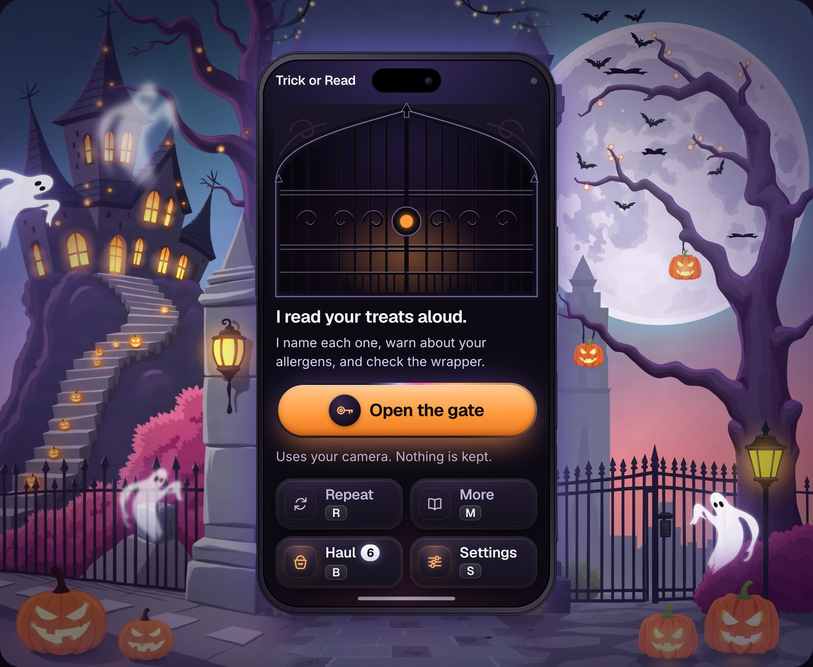
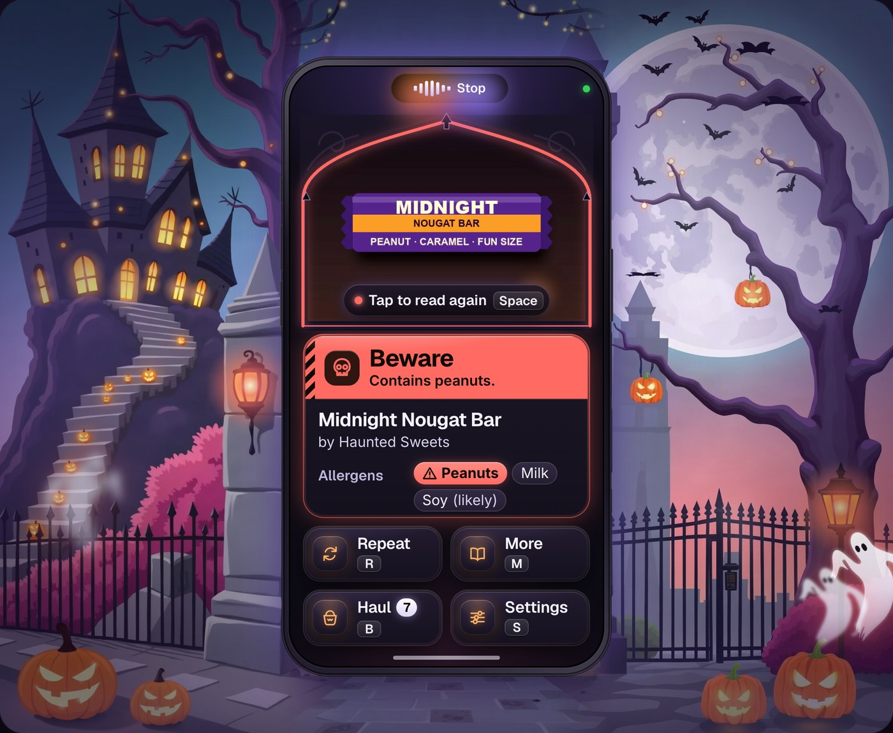
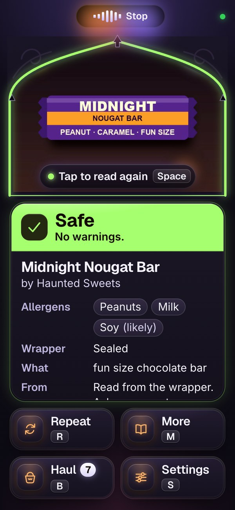
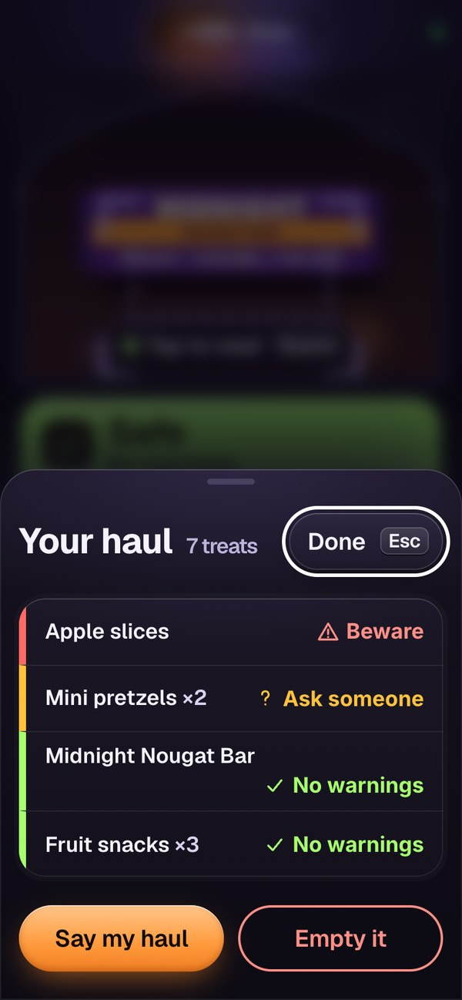

<p align="center">
  
</p>

<p align="center">
  
  
  
  
  
  
  
  
</p>

<p align="center"><em>A talking Halloween night for blind and low-vision trick-or-treaters. Hold a treat to the camera and the castle names it, checks your allergens and tells you if the wrapper is still sealed.</em></p>

<p align="center">
  
</p>

## 🔮 Screenshots

<p align="center">
  <table>
    <tr>
      <td align="center" colspan="2">
        <br>
        <sub>Gate closed, the painted night around the app</sub>
      </td>
      <td align="center" colspan="2">
        <br>
        <sub>A Beware read: peanuts</sub>
      </td>
    </tr>
    <tr>
      <td align="center" colspan="2">
        <br>
        <sub>Phone layout: no warnings</sub>
      </td>
      <td align="center" colspan="2">
        <br>
        <sub>Your haul, warnings first</sub>
      </td>
    </tr>
  </table>
</p>

<sub>Screenshots use a made-up treat and a scripted read.</sub>

<p align="center">
  
</p>

## 📦 Download and play

Grab the latest build from the [releases page](https://github.com/AXRoux/kiro-ween/releases/latest).

| Platform | File |
|---|---|
| macOS (Apple silicon) | `Trick.or.Read-<version>-arm64.dmg` |
| macOS (Intel) | `Trick.or.Read-<version>.dmg` |
| Windows | `Trick.or.Read.Setup.<version>.exe` |
| Linux | `Trick.or.Read-<version>.AppImage` (run `chmod +x` first) |

**First open on an unsigned build**

- **macOS:** right-click the app, choose Open, then click Open in the dialog. Or go to System Settings, Privacy and Security, scroll to the blocked app and click Open Anyway. On macOS 15 and later, right-click Open is no longer offered for unsigned apps, so use System Settings, Privacy and Security, Open Anyway.
- **Windows:** when SmartScreen appears, click More info, then Run anyway.
- **Linux:** `chmod +x "Trick.or.Read-<version>.AppImage"`, then run it.

**It works with no keys at all.** Barcodes are looked up in Open Food Facts and your computer's own voice is used. To add wrapper reading and the ElevenLabs voices, create a `.env` file in the app's settings folder with the same keys as `.env.example`, then restart the app.

| OS | Settings folder |
|---|---|
| macOS | `~/Library/Application Support/Trick or Read/.env` |
| Windows | `%APPDATA%\Trick or Read\.env` |
| Linux | `~/.config/Trick or Read/.env` |

The keys never leave your computer except to call those services directly. The downloads contain no keys.

<p align="center">
  
</p>

## 🎃 How it works

1. **Open the gate.** One big button, already focused: it starts the camera and lets the app speak. The wrought-iron
   gate doors swing open in 3D when the camera starts.
2. **Hold a treat still.** The app notices something new in the window, waits until it stops moving, and reads it.
   No buttons needed. To read on demand, tap the window (the whole window is the button) or press Space.
3. **Two ways to know what it is.**
   - A **barcode** in view is looked up in [Open Food Facts](https://world.openfoodfacts.org): real label data, real
     allergen lists.
   - Otherwise a **vision model** reads the wrapper. It also checks whether the wrapper is sealed, which only a camera
     can see.
4. **It speaks** with a natural ElevenLabs voice: the name, the kind, any of your allergens, and the wrapper.
   On a phone it also vibrates the verdict. Repeat says it again, More adds ingredients, sugar and calories, Haul lists
   everything you've read.

<p align="center">
  
</p>

## 👻 Never "safe" when we don't know

| Verdict | When |
|---|---|
| **Beware** | one of your allergens is on the label or likely in the treat, or the wrapper is opened, torn or unwrapped |
| **Ask someone** | you have allergens set but there is no allergen label to read, or the read was unsure |
| **Safe** | sealed, and the label lists none of your allergens |

Allergens from a label are said as facts. Allergens the model infers are said as "likely, ask someone to check the label".

<p align="center">
  
</p>

## 🕯️ Built for people who can't see the screen

- **One screen, nothing hidden.** Status bar, window, verdict, four tiles. No tabs, no pages, no gestures to learn.
- **The biggest thing does the most important thing.** The camera window is the Read button, so a blind user can find it by touch
  without hunting.
- **Controls that stay put.** Repeat, More, Haul and Settings are 64px tiles in the same corners every time, so they
  can be found by touch and by memory. Each also has a key (R, M, B, S) and a spoken word.
- **Heard, felt and seen.** Every verdict is a sentence, a sound (a chime, a bright two-note chime, a deep toll) and, on phones, a vibration
  you can count: one buzz no warnings, two ask someone, three long buzzes beware.
- **Stop her any time.** While the voice speaks, the pill at the top of the screen opens into a wave marked Stop; tap it
  (or press Esc).
- **The screen stays awake** while the camera is on, so the camera doesn't stop halfway through a haul.
- **Your screen reader, if you'd rather.** Switch the app's voice off and everything goes to VoiceOver, TalkBack or NVDA
  instead (never both, so nothing is said twice).
- **Low vision.** Interface words use **Geist** and reading text uses **Inter**, both 18px or larger at 7:1 contrast on
  every surface. Open Settings and turn on **Easier-to-read letters** to switch everything to **Atkinson Hyperlegible**
  (designed by the Braille Institute). Verdicts are solid blocks with an icon and a word, never colour alone. Respects
  reduced motion, more contrast and forced colours. axe finds no violations.

<p align="center">
  
</p>

## 🎭 The voice

Two young Brazilian women from the ElevenLabs voice library, both speaking English:
**Serena** (the default: warm, relaxed, a little playful) and **Ana** (calm and measured, every word clear).
V switches between them; the speed is in Settings. Without an ElevenLabs key the browser's own voice is used.

<p align="center">
  
</p>

## 🌕 The costume, and what each piece does

| Piece | Job |
|---|---|
| The painting | a 1120 x 920 Halloween night: the haunted mansion and lantern-lit stairs on the left, a giant lavender moon with bats on the right, twisted trees with fairy lights and hanging jack-o'-lanterns, stone pillars, iron fences, magenta bushes and carved pumpkins. The phone stands in the gate between the pillars |
| The phone | a 412 x 776 frame with a violet rim light; the screen inside (392 x 752) is the app. The painting wraps it on three sides so nothing important sits behind the phone |
| The moon | a large lavender circle that breathes and halos; bats cross it on staggered loops |
| The fairy lights and jack-o'-lanterns | every window, lantern and pumpkin in the painting has an animated glow on top of it, flickering for flames and twinkling for string lights |
| The signal lights | the pillar lantern and the lamp post carry the verdict colour: moonlight idle, green safe, amber ask someone, red beware |
| The iron gate window | the camera view in a pointed wrought-iron arch; two ornate doors swing open in 3D when the camera starts. Candlelight climbs both sides of the arch while you hold the treat still |
| The island | the black pill at the top of the screen: opens into a moving wave while the voice speaks, with a glow rising behind it, so a companion knows to listen. Tapping it (or pressing Esc) stops the voice |
| Verdict card | the verdict as a solid block (icon, word, reason: "Contains peanuts."), then the name and the facts |
| Ghosts | in the style of the WWII "Ghost Army" insignia: swooping white figures with a reaching hand and a tattered hem. They haunt the air around the phone, materialising, drifting toward it, and thinning away into mist. Their glow takes the verdict colour, so they blush red on a Beware. They disappear under reduced motion |
| Sounds | gate creak and swing (gate opens), heartbeat (holding still), chime (safe read), deep toll (beware), creak (nothing seen), all synthesised with Web Audio |

On a phone the painting comes off (the device already is the phone) and the screen fills the page. In a browser that is zoomed in too far for the painting to fit at 80%, the same happens, so text keeps the size you asked for. Cmd + / Cmd - make the whole painting bigger or smaller in the desktop app.

<p align="center">
  
</p>

## 🦇 Keys and voice commands

Space or tap the window: read · R repeat · M more · B haul · S settings · V switch voice · L voice commands · H help ·
Esc stop talking. With voice commands on: "scan", "repeat", "more", "haul", "help", "stop".

<p align="center">
  
</p>

## 🎨 About the art

The painting (`src/assets/scene.webp`) was generated for this app using FLUX image models on fal.ai (Flux Kontext and
FLUX dev image-to-image). It was painted as three panels so the phone slot sits empty in the middle and nothing
important lands behind the screen. The light sources were found automatically and are listed in
`src/components/sceneLights.ts`. The inspiration was a Halloween illustration supplied by the owner; it was not used
as a model input.

The ghost silhouette is traced from the WWII 23rd HQ Special Troops ("Ghost Army") insignia, a US government work in
the public domain, without its lightning bolts.

<p align="center">
  
</p>

## 🧪 Run from source

**Prerequisites:** [Bun](https://bun.sh) 1.1 or newer, a camera.

```sh
git clone https://github.com/AXRoux/kiro-ween.git
cd kiro-ween
bun install
cp .env.example .env   # optional: add keys for wrapper reading and the ElevenLabs voice
bun run dev            # browser at http://localhost:5173
```

Without keys it still works: barcodes via Open Food Facts, and the browser's built-in voice.

**Desktop app from source:**

```sh
bun run app            # builds and opens the painting as a desktop window
bun run dist:app       # builds installers into release/
```

**Production web server:**

```sh
bun run build && bun run start   # serves on 127.0.0.1:8787
```

By default the server listens on `127.0.0.1` only. Set `HOST=0.0.0.0` only when hosting behind your own proxy, and set `ORIGIN` and `RATE_LIMIT` then too (see `.env.example`).

```sh
bun test            # verdict rules, safety wording, allergens, stillness detector, haptics, server
bun run typecheck
```

<p align="center">
  
</p>

## 🔒 Security

API keys live only in the server process or the desktop app's main process. They are never bundled into the page, never committed to git, and the downloads contain none. The API rejects requests from any other origin (same-origin check on every `/api/` call) and is rate-limited. The server listens on `127.0.0.1` by default, so it is not reachable from the network unless you deliberately set `HOST=0.0.0.0`. Every HTML response carries a strict Content-Security-Policy. The desktop app cannot navigate away from its own origin or open other sites. See [SECURITY.md](SECURITY.md) for the full hardening list and how to report a vulnerability.

<p align="center">
  
</p>

## 📜 Built with Kiro

The original [candy-scanner spec](.kiro/specs/candy-scanner), the steering files, the first four hooks and the
painted-night redesign were written outside Kiro.

Kiro CLI did the following work in this repo:

- Wrote [`.kiro/specs/castle-desktop`](.kiro/specs/castle-desktop) from the already-implemented Electron code.
- Wrote the pure `haunt()` module and its tests, including a fix for the largest ghosts covering the edge of the screen by 8 px.
- Fixed sky ghosts clipping outside the transparent ghost window during the full animation (drift, bob and vanish).
- Added the `desktop-click-guard` agent hook, which guarded the two-window Electron setup.
- Updated the steering files to reflect the painted-night architecture, the haunt module, and the ghost SVG provenance.
- Reviewed accessibility on Dock, StatusBar and Arch; bumped the status-bar heading to 18 px and hid the idle island in the phone layout.
- Wrote [`.kiro/specs/painted-gate`](.kiro/specs/painted-gate) documenting the painted-night redesign, updated the steering and hooks, and replaced the obsolete `desktop-click-guard` hook with `scene-guard`.

The five hooks in `.kiro/hooks/` run in the Kiro IDE: `a11y-review` (accessibility check on every UI file save), `test-pure-logic` (runs unit tests when verdict or wording logic changes), `never-say-safe` (guards safety wording), `typecheck-on-stop` (typechecks when the agent stops), and `scene-guard` (guards the painted scene, ghost placement and desktop window).

<p align="center">
  
</p>

## 🕸️ Data and privacy

Frames are downscaled to 768 px, sent once per read, and never stored. Label data copyright Open Food Facts contributors, ODbL.
Logos and product names belong to their owners.

MIT licensed.

---

<p align="center">Made for Kiroween 2026</p>
